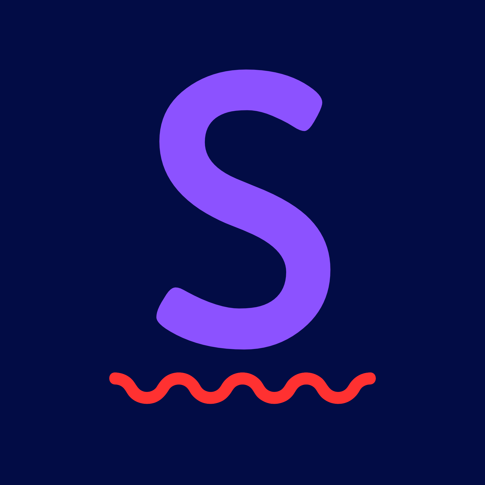
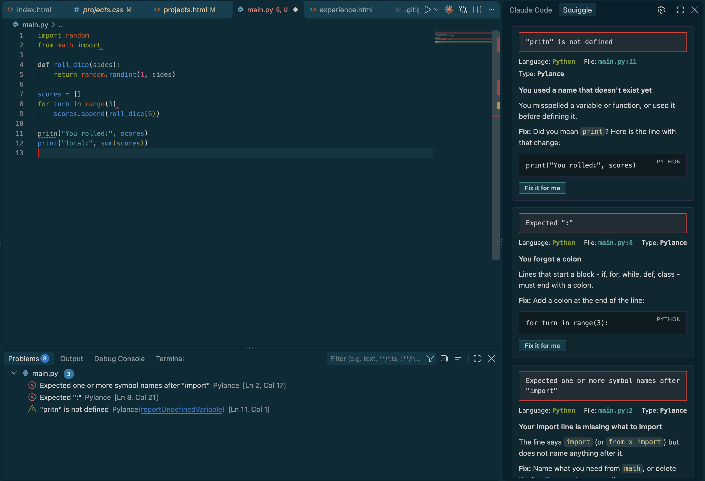

# Squiggle

Squiggle is a VS Code extension for people learning a new programming language. When you get a "Problem" notification in VSCode, a side panel explains what the error means, why it probably happened, and how to fix it. 

We were inspired by the little red squiggle you get under spelling errors!

## Installing

Get Squiggle on the [VS Code Marketplace](https://marketplace.visualstudio.com/items?itemName=varvarakarenski.squiggle-vscode).

**Requirements**
- [VS Code](https://code.visualstudio.com/) 1.106 or newer.
- For Python, Microsoft's Python extension.

After installing, open the **Squiggle** tab in the *secondary* sidebar. Troubleshooting tips are in [INSTALL.md](docs/INSTALL.md).

---

## Features

Every explanation has the same three parts:
- **Headline:** what happened, in one line.
- **Cause:** why it happened.
- **Fix:** what to change, often with a code example.

**Details**
- **Automatic, but not naggy:** it waits until you stop typing, so half-typed lines won't trigger an explanation.
- **Save-aware:** "12s after you saved auth.py" helps you connect a new error to the change that caused it.
- **Familiar error titles:** each error is shown the way a terminal prints it, with its language, file, line and source.
- **Tunable:** sliders for patience before explaining, how much hand-holding you want, and how much nearby code is used.
- **One-click copy** on every code example.
- **Fix it for me:** one click applies a safe fix, such as a typo'd name, a missing colon or curly quotes, or VS Code's own quick fix. The changed line is highlighted, and undo works as normal.
- **Native look:** colors come from your VS Code theme (light, dark or high-contrast).
- **Accessible:** works with screen readers and reduced motion, and everything is reachable by keyboard.

**Language support**

| Language | Built-in explanations |
|---|---|
| Python | 80 common errors |
| JavaScript | 48 common errors |
| TypeScript | 31 TypeScript-specific errors, plus all the JavaScript ones |

Errors outside the library still get a general explanation from pattern rules.

---

## How it works

1. You make a mistake, and VS Code underlines it with a red squiggle.
2. Squiggle waits until you stop typing (so half-typed lines are ignored).
3. Your error is cross-referenced with the explanation library (library → cache → rules).
4. The explanation appears in the side panel.

- **The extension** watches the errors VS Code reports and shows the explanation panel.
- **Explanations** come from a hand-written library of common errors first. Repeat errors come from a saved cache, and anything else is matched by pattern rules. Everything runs inside VS Code on your computer - making Squiggle instant, free, and offline.

---

## Development

1. Run `npm install` in the repo root and in `packages/vscode`.
2. Open this repo in VS Code and press **F5** to launch the extension in a new window.
3. Open the **Squiggle** tab in the secondary sidebar.

`npm run dev` starts the core on its own as a WebSocket server, for testing without VS Code.

---

## Future plans

- **More editors:** Cursor, Windsurf and VSCodium (publishing only), then Neovim and JetBrains.
- **Jupyter notebooks:** a Chrome extension that explains failing cells and finds *your* line in long pandas or NumPy tracebacks.
- **Code.org:** explanations at a student reading level for K–12 classrooms, with strict privacy defaults.
- **Terminal and runtime errors:** explain crashes, not just squiggles.
- **More languages** coming soon!

---

## License

[MIT](packages/vscode/LICENSE)
