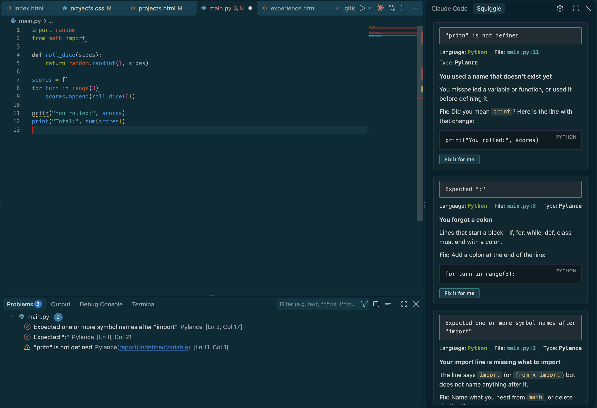

# Installing Squiggle

Squiggle can be found on Visual Studio Code Marketplace! Find us at https://marketplace.visualstudio.com/items?itemName=varvarakarenski.squiggle-vscode 

# Squiggle

Squiggle is a VS Code extension for people learning a new programming language. When you get a "Problem" notification in VSCode, a side panel explains what the error means, why it probably happened, and how to fix it. 

We were inspired by the little red squiggle you get under spelling errors!

---

## The problem

**Who it's for:** people learning a new programming language, such as **Python, JavaScript or TypeScript**. That includes students in their first real editor and developers picking up a second language.

**The problem:** error messages are written for people who already know the language. `TypeError: Cannot read properties of undefined (reading 'map')` or `error TS2339` don't help someone three weeks in. The usual fix is to copy the error, leave the editor, search, and read an answer written for experts. Confusing first errors are one of the most common reasons learners give up.

---

## Features

Every explanation has the same three parts:
- **Headline:** what happened, in one line.
- **Cause:** why it happened.
- **Fix:** what to change, often with a code example.

**Details**
- **Automatic, but not naggy:** it waits until you stop typing, so half-typed lines won't trigger an explanation.
- **Save-aware:** "12s after you saved auth.py" helps you connect a new error to the change that caused it.
- **Familiar error titles:** each error is shown the way a terminal prints it, with its language, file, line and source.
- **Tunable:** sliders for patience before explaining, how much hand-holding you want, and how much nearby code is used.
- **One-click copy** on every code example.
- **Fix it for me:** one click applies a safe fix, such as a typo'd name, a missing colon or curly quotes, or VS Code's own quick fix. The changed line is highlighted, and undo works as normal.
- **Native look:** colors come from your VS Code theme (light, dark or high-contrast).
- **Accessible:** works with screen readers and reduced motion, and everything is reachable by keyboard.

**Language support**

| Language | Built-in explanations |
|---|---|
| Python | 80 common errors |
| JavaScript | 48 common errors |
| TypeScript | 31 TypeScript-specific errors, plus all the JavaScript ones |

Errors outside the library still get a general explanation from pattern rules.

---

## How it works

1. You make a mistake, and VS Code underlines it with a red squiggle.
2. Squiggle waits until you stop typing (so half-typed lines are ignored).
3. Your error is cross-referenced with the explanation library (library → cache → rules).
4. The explanation appears in the side panel.

- **The extension** watches the errors VS Code reports and shows the explanation panel.
- **Explanations** come from a hand-written library of common errors first. Repeat errors come from a saved cache, and anything else is matched by pattern rules. Everything runs inside VS Code on your computer - making Squiggle instant, free, and offline.

**Try it:** run `npm install`, then `npm run dev` to start the core. Then open this repo in VS Code and press **F5**, and open the **Squiggle** tab in the sidebar. Full steps are in [INSTALL.md](INSTALL.md).

---

## How it was made

We built Squiggle in TypeScript: a VS Code extension, a Node.js core, and a WebSocket connection between them. We wrote the error library by hand and checked it against real error messages from Python, JavaScript and TypeScript.

**AI declaration**
- **Building it:** we used Claude Code (Anthropic) to help with scaffolding, UI work and writing library entries. The team reviewed and committed every change.
- **Inside the product:** Squiggle uses no AI. Every explanation comes from our hand-written library and rules, and nothing leaves your computer. Squiggle only changes your code when you click **Fix it for me**, and that fix comes from simple rules or VS Code's own quick fixes, never AI.

---

## Future plans

- **More editors:** Cursor, Windsurf and VSCodium (publishing only), then Neovim and JetBrains.
- **Jupyter notebooks:** a Chrome extension that explains failing cells and finds *your* line in long pandas or NumPy tracebacks.
- **Code.org:** explanations at a student reading level for K–12 classrooms, with strict privacy defaults.
- **Terminal and runtime errors:** explain crashes, not just squiggles.
- **More languages**, and publishing to the VS Code Marketplace and Open VSX.
